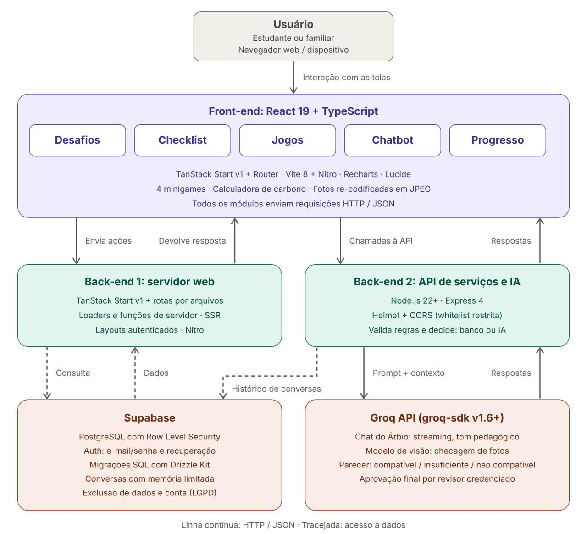

# Arquitetura Geral

Projeto **AmbiPresente**: arquitetura detalhada (3º checkpoint).

## Visão geral

O usuário (estudante ou familiar) acessa o app pelo navegador. O front-end envia ações para dois back-ends, e os dados e a IA ficam em serviços dedicados.

## Camadas

### Front-end
- React 19 + TypeScript
- TanStack Start v1 + Router, Vite 8 + Nitro
- Recharts e Lucide
- Módulos: Desafios, Checklist, Jogos, Chatbot e Progresso
- 4 minigames e calculadora de carbono
- Fotos re-codificadas em JPEG
- Comunicação com os back-ends por HTTP/JSON

### Back-end 1: servidor web
- TanStack Start v1 com rotas por arquivos
- Loaders e funções de servidor, SSR
- Layouts autenticados
- Nitro

### Back-end 2: API de serviços e IA
- Node.js 22+ e Express 4
- Helmet e CORS (whitelist restrita)
- Valida regras e decide se a requisição vai para o banco ou para a IA

### Supabase (banco de dados)
- PostgreSQL com Row Level Security
- Autenticação por e-mail e senha, com recuperação
- Migrações SQL com Drizzle Kit
- Conversas com memória limitada
- Exclusão de dados e de conta (LGPD)

### Groq API (IA)
- Chat do Árbio com streaming e tom pedagógico
- Modelo de visão para checagem de fotos
- Parecer sobre a ação: compatível, insuficiente ou não compatível
- Aprovação final por revisor credenciado

## Base de dados

Informações armazenadas:

- **Usuários:** nome, e-mail, idade, localização
- **Hábitos ambientais:** consumo de água, energia, reciclagem
- **Desafios:** atividades sustentáveis, tarefas concluídas, desafios diários
- **Pontuação:** pontos adquiridos, recompensas, nível do usuário
- **Jogos educativos:** jogos disponíveis, acertos, erros, evolução
- **Relatórios:** histórico de atividades, estimativa de redução de danos, interesse dos usuários, relatório mensal de download
- **Comprovação de ações:** fotos e vídeos enviados pelo usuário
- **Interação com a IA:** perguntas realizadas, assuntos pesquisados, recomendações do chatbot

## Conteúdo educativo e fontes

Temas: reciclagem, pegada de carbono, consumo consciente, preservação ambiental, economia de água, energia e mudanças climáticas.

Fontes confiáveis: Ministério do Meio Ambiente, IBAMA, ONU Meio Ambiente, Instituto Akatu, UNICEF e livros de educação ambiental.

Para validar o chatbot, são criados exemplos de perguntas para testar se ele entende os assuntos e responde com informações corretas e na linguagem adequada a cada faixa etária.
