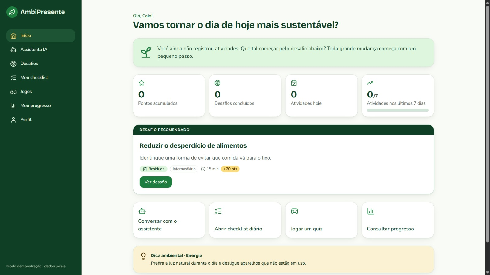
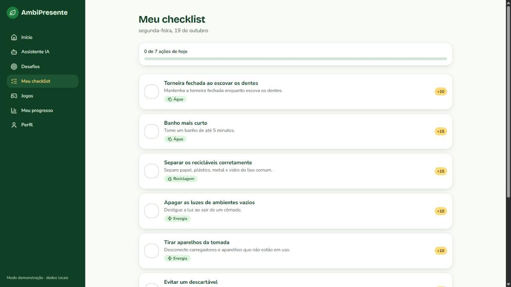
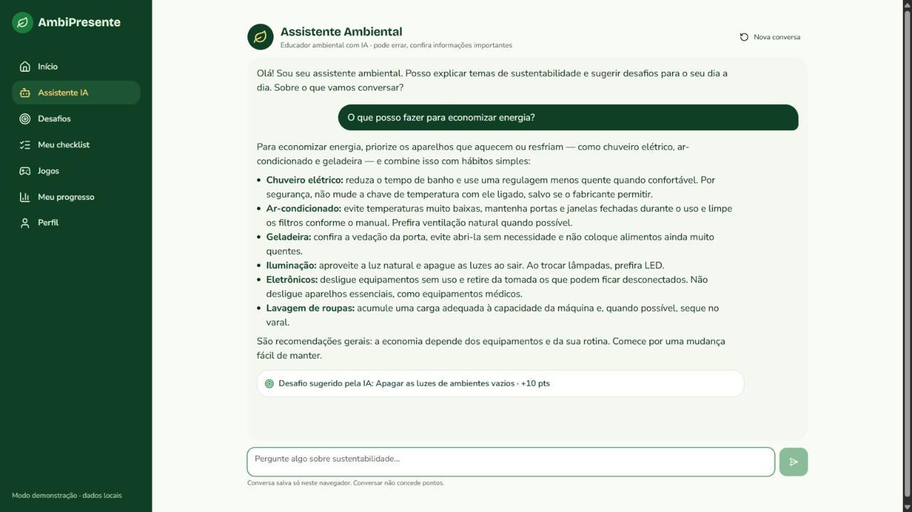

# AmbiPresente 🌱

Aplicativo que ensina hábitos sustentáveis de forma interativa e participativa,
por meio de desafios diários, checklist, jogos educativos e um assistente com IA (o Árbio).

## Integrantes
- André Victor Cardoso Rodrigues
- Caio Quaglio
- Raissa Gabrielle Silva da Fonseca

## Links
- **MVP (no-code):** https://ambi-presente.lovable.app
- **Protótipo:** não houve etapa separada de protótipo; o grupo partiu direto
  para o MVP. As telas estão logo abaixo.
  ## Telas do MVP

## Como acessar os artefatos
- `docs/requisitos/`: requisitos funcionais, não funcionais e priorização MoSCoW
- `docs/Arquitetura/`: arquitetura geral e diagrama de componentes
- `docs/Planejamento/`: cronograma dos checkpoints e product backlog
- `assets/images/`: capturas de tela do MVP

## Status do projeto
MVP funcional publicado. 3º checkpoint entregue em 24/11/2026.
Próximos passos: configuração e publicação dos recursos de IA, ampliação dos
minigames e aprimoramento do relatório de pegada de carbono.
